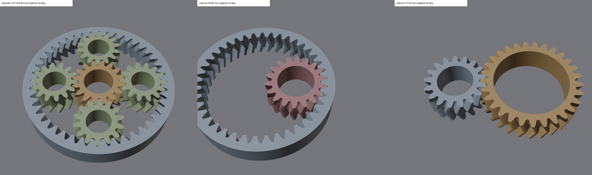
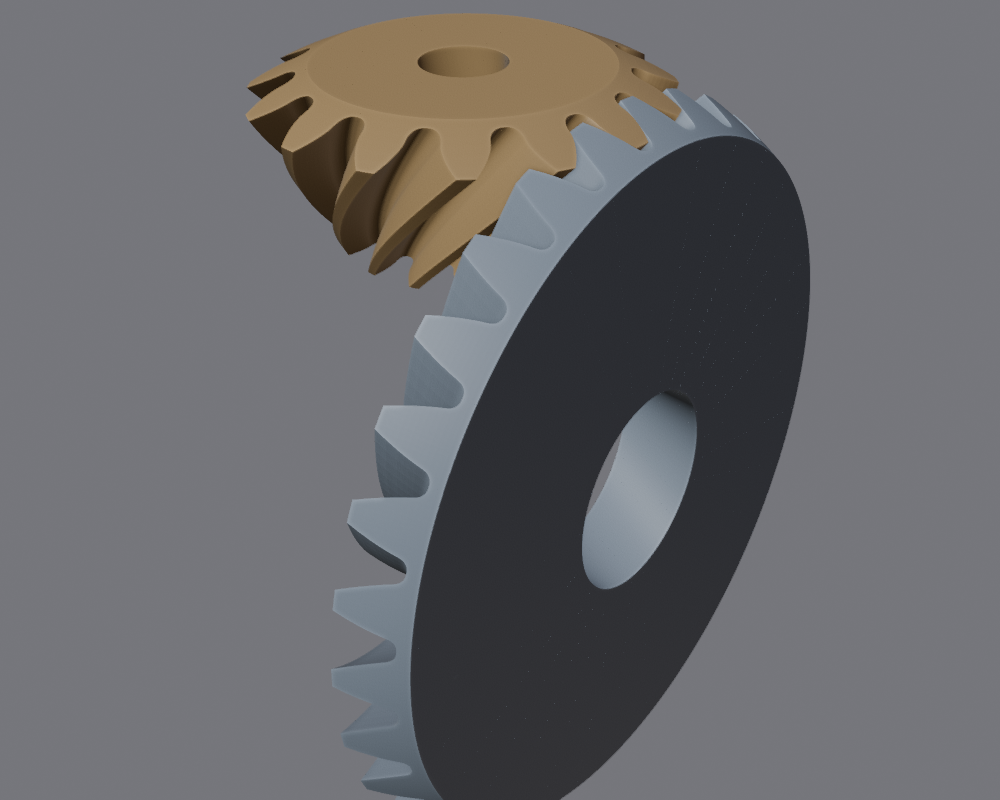
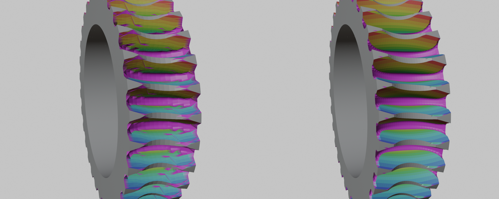

# Gear Lapping

Blender add-on that makes gears as real geometry: ready-made gears and pairs
by their parameters, and gears cut by each other. One gear (the tool) rolls
over a blank and takes away everything its teeth sweep, so the blank gets the
exact mating teeth. Then the roles can be swapped. Made for FDM printing.

## What it makes

Sidebar of the 3D viewport, four tabs:

- **Gear**: one gear by its parameters: cylindrical (spur, helical,
  herringbone), internal ring, bevel, rack, worm.
- **Gear Pair**: gears in mesh: external, internal, planetary (sun, planets on
  a carrier, ring), bevel (straight, spiral, herringbone), rack and pinion,
  worm and worm wheel, worm and rack, cycloidal clock pair, Swiss lever
  escapement, gravity escapement.
- **Lapping**: a tool (any gear, or your own body made a gear), a blank (by
  the teeth in mesh, or by dimensions), the ratio and a whole-number slowdown,
  then the imprint and the reverse pass.
- **Chain & Belt**: roller chain sprockets (ISO 606 / ANSI) and timing belt
  pulleys (GT2, HTD, T, MXL, XL, H), single or as a pair at the center
  distance of a whole number of links or belt teeth.

Every tab ends with the Print block: print offset, chamfer against the
elephant foot, nozzle and layer, overhang check, printable copy, STL export.

## How a gear is stored

A gear is an empty (its local Z is the rotation axis) with one mesh element
per tooth as children. All elements share one mesh, so editing one tooth by
hand changes all of them. The pieces are open at their sides; the printable
copy joins them into one closed solid and never changes the gear itself.

## How the imprint works

- Parallel axes and straight bevel pairs: one section of the blank (a plane,
  or a sphere about the common apex) is cut in 2D by every position of the
  tool, and the element is built again from the new outline.
- Other placements: slices across the element, each cut the same way, then
  lofted.
- Cut faces are coloured by the order of the steps that cut them. Faces that
  cannot pass torque (cut by a tip, a root or a corner of the tool) are marked
  as parasitic and can be replaced by simple surfaces with clearance.
- Starter teeth follow the GOST 13755 basic rack (involute flanks, root
  fillets, undercut included). Bevel teeth are built by formula on the sphere.

## Install

- Blender 4.5 or newer (tested with 5.2 LTS). No extra Python packages.
- Edit > Preferences > Add-ons > Install from Disk, pick `gear_lapping.py`.
- 3D viewport > sidebar (N) > tabs "Gear", "Gear Pair", "Lapping",
  "Chain & Belt".
- 1 Blender unit = 1 mm. The default module is 1.5 mm.

The long comment at the top of `gear_lapping.py` describes every method and
formula in detail.

## Status

- Typical build times on a slow machine: external pair 3 s, internal pair
  4 s, planetary set 7 s, worm pair 18 s, the others under 2 s.
- The pictures were made with earlier versions of the add-on.
- The related project for a rack with a variable-radius pinion (constant
  torque / constant force) is a separate add-on: Rack CT-CF.
